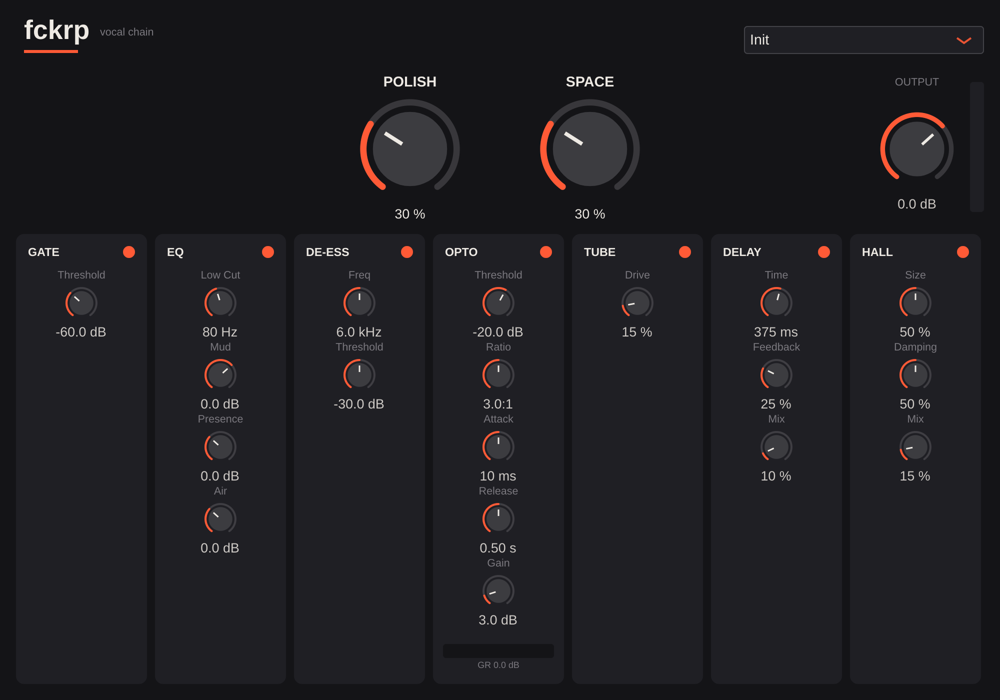

# fckrp

Eine komplette Vocal-Kette in einem Plugin, für FL Studio und andere DAWs (VST3 für Windows und Mac, zusätzlich AU auf dem Mac).



## Was drin ist

Das Signal läuft in dieser Reihenfolge durch die Module. Jedes Modul lässt sich mit dem Punkt oben rechts an- und ausschalten.

| Modul | Was es macht |
|---|---|
| **Gate** | Senkt Rauschen und Atmer zwischen den Phrasen sanft ab, statt hart abzuschneiden. |
| **EQ** | Low Cut gegen Rumpeln, „Mud“ bei 300 Hz, „Presence“ bei 3,5 kHz für Verständlichkeit, „Air“ ab 10 kHz für Glanz. |
| **Tame** | Dynamischer Resonanz-Zähmer: acht schmale Bänder zwischen 1,2 und 9 kHz. Ein Band, das deutlich lauter ist als seine Nachbarn (eine schrille, „klingelnde“ Frequenz), wird nur in diesem Moment abgesenkt. Regler: Depth (bis 12 dB), Sensitivity. |
| **De-Ess** | Macht scharfe S- und Zischlaute leiser, nur im Höhenbereich. |
| **Opto** | Eigener optischer Röhrenkompressor: sehr weiche Kennlinie, zweistufiges Release (schneller Anteil plus langsamer Ausklang) und „Gedächtnis“, das nach langer Kompression langsamer loslässt. Regler: Threshold, Ratio, Attack, Release, Gain und **Mix** für Parallel-Kompression (100 % = voll komprimiert, weniger = Original wird beigemischt). |
| **Tube** | Röhrensättigung mit 2-fach-Oversampling. Regler: Drive und **Character** (0 % = weich und sauber, 100 % = heiß und kräftig, mit mehr warmen Obertönen; Standard 100 %). |
| **Doubler** | Zwei zusätzliche „Takes“ aus kurzen, leicht schwankenden Verzögerungen (ca. 14 und 21 ms, bis etwa ±10 Cent verstimmt), links und rechts verteilt. Monosicher: in Mono klingt die Stimme genau wie ohne Doubler. Regler: Amount, Detune. Standardmäßig aus. |
| **Delay** | Echo, das zum trockenen Signal dazugemischt wird. Die Wiederholungen sind gefiltert, damit sie hinter der Stimme bleiben. |
| **Hall** | Raum, der dazugemischt wird, mit Low Cut am Halleingang gegen Matsch. |

**Makro-Regler:**
- **Polish** macht die Stimme mit einem Dreh „fertiger“: mehr Kompression, mehr Presence und Air, etwas mehr De-Essing und Wärme.
- **Space** gibt mehr Delay, Hall und Stereobreite dazu.
- **Width** regelt die Stereobreite (0 % = mono, 100 % = unverändert, 200 % = doppelt so breit). Was man in Mono hört, bleibt dabei unverändert.

**Presets:** Init, Clean Pop, Rap Upfront, Airy R&B, Lo-Fi Warm, Big Hook, Natural Leveler.

## In FL Studio installieren

1. Auf GitHub unter **Actions** den neuesten erfolgreichen Lauf von „Build“ öffnen und unten bei *Artifacts* `fckrp-Windows` oder `fckrp-macOS` herunterladen und entpacken.

**Windows**

2. Den Ordner `fckrp.vst3` nach `C:\Program Files\Common Files\VST3\` kopieren.

**Mac (am einfachsten)**

2. Im entpackten Ordner `fckrp-Installer.pkg` mit **Rechtsklick → Öffnen** starten (ein normaler Doppelklick wird von macOS blockiert, weil das Paket noch nicht bei Apple beglaubigt ist) und durchklicken. Das installiert fckrp nach `/Library/Audio/Plug-Ins/VST3` und `/Library/Audio/Plug-Ins/Components`, also genau dorthin, wo FL Studio sucht.
   Falls macOS trotzdem blockiert: *Systemeinstellungen → Datenschutz & Sicherheit → Trotzdem öffnen*.

**Mac (von Hand)**

2. `fckrp-vst3.zip` entpacken und `fckrp.vst3` nach `/Library/Audio/Plug-Ins/VST3` legen (Finder: *Gehe zu → Gehe zum Ordner…*).
3. Einmal im Terminal ausführen: `sudo xattr -dr com.apple.quarantine /Library/Audio/Plug-Ins/VST3/fckrp.vst3`
4. Wer das Plugin stattdessen in den Benutzerordner `~/Library/Audio/Plug-Ins/VST3` legt, muss diesen Ordner in FL Studio unter *Manage plugins → Plugin search paths* hinzufügen. Standardmäßig sucht FL Studio dort nicht.

**Dann in FL Studio**

5. *Options → Manage plugins → Find installed plugins* (mit Haken bei *Rescan previously verified plugins*). Danach erscheint fckrp unter den Effekten und kann in einen Mixer-Insert geladen werden.

## Selbst bauen

Voraussetzungen: CMake 3.22+ und ein C++17-Compiler (Visual Studio 2022, Xcode oder GCC/Clang). JUCE wird automatisch heruntergeladen.

```
cmake -B build -DCMAKE_BUILD_TYPE=Release
cmake --build build --config Release --target fckrp_VST3
```

Offline-Tests (prüfen alle Presets bei mehreren Sample-Raten, Kompressor, De-Esser, Ausklang, Mono und Speichern/Laden):

```
cmake -B build -DCMAKE_BUILD_TYPE=Release -DFCKRP_BUILD_TESTS=ON
cmake --build build --target fckrp_tests
./build/fckrp_tests_artefacts/Release/fckrp_tests
```

## Geplant

- Version 2: Echtzeit-Tonhöhenkorrektur (Auto-Tune-Stil)
- Eigene Presets speichern und teilen
- Tempo-Sync für das Delay
- Überarbeitetes Design

## Lizenz-Hinweis

fckrp basiert auf dem JUCE-Framework. JUCE ist entweder unter AGPLv3 (dann muss der Quellcode offen sein) oder mit einer JUCE-Lizenz nutzbar; die kostenlose „Starter“-Lizenz gilt bis zu einem bestimmten Jahresumsatz. Vor einem Verkauf bitte die aktuellen Bedingungen auf juce.com prüfen.
