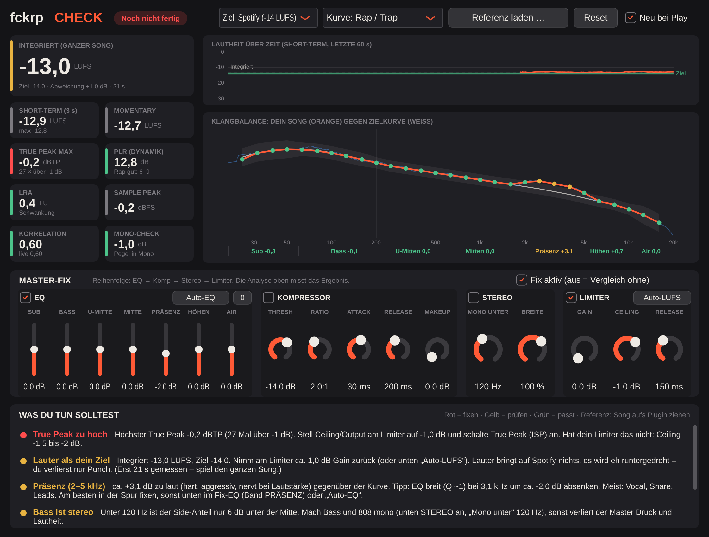

# fckrp check – Master-Analyzer

Kommt in FL Studio in den **letzten Slot vom Master**. Misst, ob dein Master für Spotify passt,
sagt dir was du ändern solltest und hat eine eigene Master-Kette zum Fixen (EQ, Kompressor,
Stereo, True-Peak-Limiter). Solange alle Module aus sind, bleibt der Sound unverändert.



## Was gemessen wird

- **Integriert (LUFS)**: Lautheit vom ganzen Song (EBU R128 / ITU BS.1770, mit Gating)
- **Short-Term / Momentary**: Lautheit der letzten 3 s / 0,4 s
- **True Peak**: echte Spitzen zwischen den Samples (4x Oversampling), Ziel ≤ -1 dBTP
- **PLR**: Abstand Peak zu Lautheit = wie stark limitiert (Rap meist 6–9 dB)
- **LRA**: wie stark die Lautstärke zwischen Parts schwankt
- **Klangbalance**: Spektrum vom ganzen Song gegen eine Zielkurve (Rap/Trap, Pop/R&B oder
  eine eigene Referenz) mit Tipps wie „2–5 kHz ca. +3 dB zu laut → bei 3,1 kHz -2 dB“
- **Spitzen/Resonanzen**: schmale Peaks, die klingeln oder pfeifen
- **Stereo**: Korrelation, Pegelverlust in Mono, ob der Bass unter 120 Hz mono ist

## Master-Fix

- **EQ**: 7 breite Bänder (Sub, Bass, U-Mitte, Mitte, Präsenz, Höhen, Air), passend zu den Tipps.
  „Auto-EQ“ korrigiert ca. 60 % der gemessenen Abweichung, nochmal abspielen und wieder drücken verfeinert.
- **Kompressor**: sanfter Glue-Kompressor (Standard 2:1, 30 ms / 200 ms).
- **Stereo**: „Mono unter“ macht Bass/808 mono, „Breite“ für die Stereobreite.
- **Limiter**: True-Peak-Limiter mit Look-ahead (1,5 ms), Ceiling -1 dB. „Auto-LUFS“ stellt den
  Gain so ein, dass dein Ziel erreicht wird.
- „Fix aktiv“ aus = Vergleich ohne die Kette.

Die Analyse misst immer das, was aus dem Plugin rauskommt.

## So benutzt du es

1. Plugin in den letzten Slot vom Master (nach dem Limiter).
2. Ziel wählen: Spotify (-14), Rap laut (-9) oder Maximal laut (-7).
3. Song von Anfang bis Ende abspielen. Bei Play fängt die Messung automatisch neu an.
4. Unten stehen die Tipps: Rot = fixen, Gelb = prüfen, Grün = passt.
5. Am Limiter/EQ drehen, nochmal abspielen, bis oben „Spotify-ready“ steht.

**Eigene Referenz:** Einen fertigen Song aus deinem Genre (WAV, MP3, AIFF, FLAC, M4A) einfach auf das
Plugin ziehen oder „Referenz laden …“ klicken. Danach vergleicht das Plugin deinen Song mit genau
diesem Klang; mit Ziel „Wie Referenz“ auch mit seiner Lautheit.

Auf dem Master ist alles schon zusammengemischt: das Plugin kann Beat und Vocal nicht
getrennt hören. Es sagt dir, welcher Frequenzbereich das Problem ist und was dort meistens
drin ist (z. B. 2–5 kHz = Vocal, Snare).

## Bauen

```
cmake -B build -DCMAKE_BUILD_TYPE=Release
cmake --build build --target fckrp_check_VST3 fckrp_check_AU
# Tests:
cmake -B build -DCHECK_BUILD_TESTS=ON && cmake --build build --target mastercheck_tests
./build/mastercheck_tests_artefacts/Release/mastercheck_tests --editor
```
